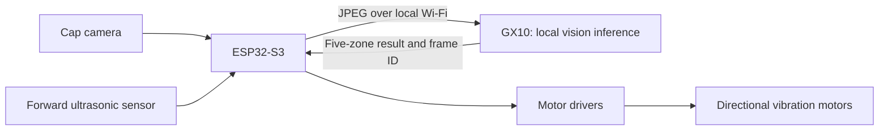

# RAGging Canes

A wearable obstacle-awareness prototype that turns camera observations into directional vibration cues. Built for the ASUS Local AI track at the UCSC AI Hackathon, October 10–11, 2026.

The concept is a baseball cap with a Freenove ESP32-S3 WROOM board, a camera, and vibration motors. Images travel over a local network to an ASUS Ascent GX10 for AI processing. The intended cap will use the results to indicate where objects appear relative to the wearer's head, with a separate ultrasonic sensor providing forward proximity feedback. The current implementation covers image processing and the array-delivery software; motor and ultrasonic integration are still planned.

## Project status

The GX10 continuously fetches live JPEGs from the ESP32, runs `nemotron3:33b`, and serves the latest five-zone result over HTTP. SSH key access is working. A polling module is ready to add to the camera sketch on the separate Mac, but receipt on the physical ESP32 has not been verified. GPIO assignments, motor feedback, training scripts, and an integrated wearable demo remain pending.

| Component | Status |
| --- | --- |
| ESP32 JPEG capture → GX10 | Working |
| Continuous local Nemotron inference | Running on GX10 |
| GX10 result endpoint | Working; reachable from development Mac |
| ESP32 result receiver | Module compile-checked for ESP32-S3; needs integration and USB upload on the other Mac |
| Motor output | Not implemented; current scope is array delivery only |

## How the current software works

There are two HTTP request loops. The GX10 requests images from the ESP32, and the ESP32 receiver requests results from the GX10 once that receiver is added to the camera sketch.

1. **The ESP32 serves the camera.** Its existing firmware provides a camera page, a `/capture` JPEG endpoint, and a video stream on port 81. The working camera sketch is on the other Mac and is not included in this repository.
2. **The GX10 fetches a snapshot.** `gx10/service.py` requests `/capture` and reads one JPEG. It uses snapshots rather than processing the browser's video stream.
3. **Nemotron processes that JPEG locally.** The service calls Ollama on the GX10 with `nemotron3:33b`, thinking disabled, a short prompt, and a JSON schema requiring five values. The prompt asks for people, chairs, tables, or boxes in five equal vertical image zones.
4. **The GX10 publishes the validated result.** It stores the latest array with a frame ID, session ID, timing, and expiry. `/command` returns that stored result immediately; polling it does not trigger another model request. The capture loop then processes its next frame.
5. **The ESP32 polls for the array.** `firmware/ZoneClient.h` starts a background task that requests the GX10's `/command` endpoint approximately every 200 ms plus request time. It validates the JSON and remaining lifetime, then prints new arrays to Serial Monitor. This step requires uploading the modified camera sketch first.
6. **Future code can use the array.** `zoneClient.read(zones)` returns the current values, or five `-1` values if unavailable or expired. There are no motor GPIO writes in the current module.

```text
GX10 -- GET /capture --> ESP32 camera
GX10 <-- JPEG ---------- ESP32 camera
GX10 --> local Ollama / nemotron3:33b --> five-zone array

After the receiver module is flashed:
ESP32 -- GET /command --> GX10
ESP32 <-- JSON array + freshness metadata -- GX10
ESP32 --> Serial Monitor on its USB-connected Mac
```

The Mac connected to the ESP32 programs the board and shows its serial output. It does not need to relay images or run the AI; the ESP32 and GX10 communicate directly over the network.

## Repository guide

| File | What it does |
| --- | --- |
| [gx10/service.py](gx10/service.py) | Continuous capture/inference loop, latest-result state, expiry, and HTTP endpoints. |
| [tools/benchmark_vision.py](tools/benchmark_vision.py) | One-off file or live-camera benchmarks; also defines the prompt and output schema used by the service. |
| [firmware/ZoneClient.h](firmware/ZoneClient.h) | ESP32 polling and serial-output module to add to the existing camera sketch. |
| [firmware/README.md](firmware/README.md) | Instructions for integrating and uploading that module from the other Mac. |
| [tests/test_service.py](tests/test_service.py) | Server tests for malformed output, expiry, errors, recovery, and HTTP responses. |

The repository does not contain the full existing camera sketch, model weights, a trained checkpoint, or motor-control firmware. Ollama uses models already installed on the GX10.

## Intended experience

The cap communicates the direction of visible objects through five positions:

**Left · Leftish · Center · Rightish · Right**

A vibration indicates where an object is detected. Cues are relative to the camera and the wearer's head, which may point differently from their walking direction. Forward proximity uses a distinct pulse pattern based on the ultrasonic reading.

The original hardware plan includes six motors: five directional motors and a possible rear status motor. The latest prototype discussion focuses on the five directional zones; the sixth motor's role remains optional. A rear status cue would indicate conditions such as a lost connection, not an object behind the wearer.

The first demo should have a stationary wearer identify the direction of objects moved within the camera view. This is an experimental awareness aid; silence does not establish that a path is clear, and the prototype is not a replacement for existing mobility aids.

## Planned architecture



The two feedback paths have separate responsibilities:

| Path | Purpose |
| --- | --- |
| Camera → GX10 → ESP32 → motors | Indicate the horizontal location of recognized objects. |
| Ultrasonic → ESP32 → motors | Provide measured forward proximity feedback without waiting for image inference or Wi-Fi. |

One ultrasonic reading does not provide a distance for every camera detection. Camera detections alone should not be treated as measured distance or a safe-navigation instruction.

The planned demo runs inference locally on the GX10 and communicates over the local network. A compact model running directly on the ESP32 is a possible future direction, not the current deployment plan.

## Hardware

| Component | Role / current detail |
| --- | --- |
| Baseball cap | Wearable mount for the camera and haptics. |
| Freenove ESP32-S3 WROOM board | Camera capture, networking, sensor input, and motor control. |
| Camera module | Forward-facing JPEG source; exact module and pin mapping still need documentation. |
| Five directional vibration motors | Bare two-wire motors; exact type, ratings, and driver circuit still need confirmation. |
| Optional sixth motor | Reserved in the original plan for a distinct status cue. |
| Ultrasonic sensor | Reported as a 3 V sensor; exact model, range, and signal levels remain to be verified. |
| Motor drivers and power supply | Must be selected for the actual motors; bare motors must not be powered directly from GPIO. |
| ASUS Ascent GX10 | Local model experimentation, inference, and planned training. |
| Development laptop and local network | Programming, debugging, and remote access to the GX10. |

An exact wiring map is pending identification of the camera, sensor, and motor parts, along with the board's available GPIOs.

## Vision and haptic output

The selected vision model is **`nemotron3:33b`**, running locally through Ollama on the GX10 with thinking disabled. Use this exact model tag for camera testing and integration; it is the benchmark script's default. Earlier Gemma measurements are retained below as comparison data. Directional accuracy and capture-to-vibration latency still need further validation.

The compact vision output is an array ordered left to right:

```json
[0, 1, 1, 0, 0]
```

| Value | Meaning |
| --- | --- |
| `1` | A target object is detected in this zone. |
| `0` | No target object was detected in this zone. |
| `-1` | The zone could not be assessed. |

An object may occupy multiple zones. The current prompt looks for people, chairs, tables, and boxes. It does not detect every possible obstacle. Unknown results require distinct handling and must not be silently converted to a clear scene.

The service validates this detection format and includes it as `zones` in the `/command` response, alongside a frame identifier and expiry metadata. It is not an electrical motor command. Haptic pulse patterns and priority between proximity, direction, and status cues still need to be defined.

## Latency plan

The initial engineering target discussed is approximately **200–500 ms from a scene change to noticeable vibration**. This has not been demonstrated on the integrated hardware.

- Keep the model loaded and disable thinking for short directional responses where supported.
- Process one image per request without accumulating conversation history.
- Compare 640×480 and 320×240 JPEG input for both missed detections and delay.
- Allow one inference request at a time and keep only the newest waiting frame.
- Return compact results and reject malformed, incomplete, or expired responses.
- Keep ultrasonic sensing and motor timing independent of network waits.
- If the vision-language models are too slow, evaluate a small object detector for the directional loop.

Benchmark with different images after warming up the model, including left, center, right, and empty scenes. Record missed detections, false detections, unstable zone changes, typical latency, and slow responses. Measure the full camera → network → inference → response → motor path, not just text generation time.

## Training workstream

The team identified training as a track requirement. The planned approach is to fine-tune a small detector on the GX10 using an existing labeled dataset, then evaluate it on images from the actual cap camera. This keeps data collection manageable within the hackathon.

1. Confirm the accepted training deliverable with the organizers.
2. Prove that the selected model can run on its intended deployment device.
3. Choose a narrow set of classes supported by the dataset.
4. Run one training epoch to estimate the time budget, then complete a bounded training run.
5. Save the checkpoint, dataset details, configuration, and training results.
6. Compare the baseline and trained model on held-out examples and real cap-camera images.

Inference with an existing model does not complete this workstream. No trained checkpoint or measured accuracy improvement is currently included in this repository.

## Getting started

Clone the repository using a GitHub account with access:

```bash
git clone git@github.com:hjo3-cse40/RAGging-Canes.git
cd RAGging-Canes
```

Put the laptop, ESP32, and GX10 on a network that allows device-to-device communication. The ESP32 is connected to a separate Mac for programming and currently serves a working camera page. GX10 access to that camera has been verified.

Once the GX10's username and network address are known, connect from the laptop with:

```bash
ssh USERNAME@GX10_IP
```

Replace both placeholders with the assigned values. Keep credentials and device-specific network settings out of the repository.

### Continuous service and return channel

On the GX10, run from the repository root (replace the address placeholders):

```bash
python3 -m gx10.service --camera-url http://ESP32_IP/capture \
  --bind GX10_IP --port 8000
```

The service uses Python's standard library and the existing local Ollama installation. It processes one frame at a time without building a frame queue. The model is fixed to `nemotron3:33b` with thinking disabled.

| Endpoint | Purpose |
| --- | --- |
| `GET /command` | Latest array, validity, remaining lifetime, and frame ID; polled by the ESP32. |
| `GET /health` | Same state plus timing and polling diagnostics, without counting as a command poll. |
| `GET /firmware/ZoneClient.h` | Download the ESP32 polling module on the other Mac. |
| `GET /firmware/README.md` | Download the sketch integration instructions. |

An example command response includes:

```json
{"frame_id":12,"model":"nemotron3:33b","status":"ok","valid":true,"zones":[0,1,1,0,0],"ttl_ms":1100}
```

The real response also includes a session ID, frame age, and timing fields. Freshness expires 2500 ms after the GX10 starts fetching the frame, including capture and inference time. A startup, error, or expired result has `valid: false`, `ttl_ms: 0`, and five `-1` values. The age cannot account for older frames buffered inside the camera. This timeout is a prototype setting, not a validated safety threshold. The HTTP endpoint stays available while inference is busy.

The current GX10 instance runs as the transient user service `ragging-canes.service`:

```bash
systemctl --user status ragging-canes
journalctl --user -u ragging-canes -f
systemctl --user stop ragging-canes
```

It remains running after the SSH command exits and restarts after process failures. It is not installed as a boot service; after a reboot, start it again using the Python command above. Stop the running instance before starting another copy on the same port.

**To finish the return path:** follow [the ESP32 integration instructions](firmware/README.md) on the Mac connected to the board. Add `ZoneClient.h` to the existing camera sketch, create the client with `http://GX10_IP:8000/command`, and call `begin()` after camera/Wi-Fi setup. The module prints received arrays and supports `read()` for later use. It does not touch motor pins. Confirm actual receipt in Serial Monitor after upload.

### Check results from the Mac connected to the ESP32

First get this repository onto that Mac using the clone command above. If it is already cloned, run `git pull --ff-only` from its repository folder. Copy `firmware/ZoneClient.h` into the working camera sketch folder and follow [the upload steps](firmware/README.md).

To check that the GX10 is serving arrays, replace `GX10_IP` with its current address:

```bash
curl http://GX10_IP:8000/command
```

To watch repeated responses, press Ctrl+C when finished:

```bash
while true; do
  curl --max-time 3 -sS http://GX10_IP:8000/command
  echo
  sleep 1
done
```

| Response field | How to read it |
| --- | --- |
| `zones` | Five entries ordered left, leftish, center, rightish, right. |
| `valid` | The response passed validation and remains within its freshness budget; not a guarantee of correct detection. |
| `status` | `starting`, `ok`, `stale`, or `error`. |
| `frame_id` | Successful inference counter within this service session; printed by the ESP32 receiver. |
| `session_id` | Changes when the service restarts, so frame counters from different sessions are distinguishable. |
| `frame_age_ms` | Milliseconds since the GX10 began fetching this image. |
| `ttl_ms` | Remaining lifetime; zero means the receiver must not use the array. |

To verify that the **physical ESP32 receives and parses** the array, use Arduino Serial Monitor or find its serial port in Terminal:

```bash
ls /dev/cu.*
```

Then open the actual `usbmodem` or `usbserial` port (replace the example name):

```bash
screen /dev/cu.usbmodemXXXX 115200
```

Use the baud rate configured by the existing camera sketch if it differs from 115200. Close Arduino Serial Monitor before using `screen`. Exit `screen` with Ctrl+A, then K, then Y. After the receiver module is uploaded, expect lines such as:

```text
Frame 12 zones: [0,1,1,0,0]
```

`curl` checks the GX10 endpoint; the serial line confirms the ESP32 parsed a response. The `/health` endpoint's `last_client_ip` and `poll_count` also help diagnose polling, but browser requests update those fields too.

### Compare detections with the camera view

Open `http://ESP32_IP/` and move a person or chair into the left, center, and right of the view, holding each position for several seconds. Look for corresponding zone changes in Serial Monitor. The browser image will usually be newer than the image the model processed, and intermittent camera failures can delay results further.

The current service does **not** save or display the exact processed JPEG alongside its frame ID. A matching frame ID connects the serial output to a model response, not to a particular frame visible in the browser. Exact image/result alignment needs a paired-image debug view, which is not implemented yet.

### Validation

Server checks:

```bash
python3 -m unittest discover -s tests -v
```

Tests cover startup, valid results, expiry including inference time, stale polls, invalid model responses, error recovery, and the HTTP response contract.

### Run a vision benchmark on the GX10

The current GX10 checkout is `/home/asus/projects/RAGging-Canes`. The benchmark uses Python's standard library and the existing local Ollama service; it needs no additional Python packages.

```bash
cd /home/asus/projects/RAGging-Canes
python3 tools/benchmark_vision.py --model nemotron3:33b --rounds 2 \
  /absolute/path/image1.jpg /absolute/path/image2.jpg
```

Omitting `--model` also selects `nemotron3:33b`. Each output line is JSON with the image hash, five-zone response, response validity, wall time, and available Ollama timing fields. Requests disable thinking and constrain output with a JSON schema using the [Ollama chat API](https://docs.ollama.com/api/chat). Invalid or incomplete responses make the script exit with a nonzero status.

The first request can include model loading. Later rounds repeat the same files and may benefit from caching. `valid: true` means the response format passed validation; it does not establish detection accuracy. File-mode timings exclude ESP32 capture, Wi-Fi transfer, and motor startup.

### Test live ESP32 frames

The current camera page identifies itself as **ESP32 OV2640** and exposes `/capture` for JPEG snapshots and `http://ESP32_IP:81/stream` for video. Replace `ESP32_IP` with the board's current address:

```bash
python3 tools/benchmark_vision.py --model nemotron3:33b --rounds 5 \
  --camera-url http://ESP32_IP/capture
```

This mode fetches a JPEG for each round, records its hash and fetch time, then runs inference. `wall_ms` includes the HTTP camera fetch and the Ollama request, but excludes motor output and does not measure the age of the image already buffered by the camera. Stop the continuous service before benchmarking to avoid competing inference and camera requests. The continuous service also pulls frames; its `/command` endpoint provides the return channel once the ESP32 polling module is flashed.

### Initial measurements — October 10, 2026

| Test | Observed wall time |
| --- | --- |
| Nemotron, first desktop-image request including model load | 7.31 s |
| Nemotron, two other desktop images with the model loaded | 0.70–0.74 s |
| Gemma, first desktop-image request including model load | 5.43 s |
| Gemma, two other desktop images with the model loaded | 0.93–0.96 s |
| Nemotron, three live ESP32 fetch-and-inference requests with the model loaded | 1.28–1.35 s |

Both models returned valid arrays for six desktop-image requests each. Three live captures had distinct hashes and valid arrays; JPEG fetches took 0.55–0.63 s and Ollama processing took 0.69–0.74 s. These small samples establish connectivity and response formatting, not detection accuracy or safe response times. They exceed the initial 200–500 ms target before motor latency is included.

An earlier live-camera attempt hit the 10-second capture timeout before the successful three-frame run. Camera availability under streaming and repeated capture still needs testing; a failed capture must not be interpreted as an empty scene.

During continuous-service testing, the camera also intermittently timed out or refused connections. The endpoint invalidated its results and recovered on subsequent successful captures. The full return path still needs a hardware test after the polling module is flashed.

## Build milestones

- [ ] Confirm component models, power requirements, and GPIO assignments.
- [x] Fetch JPEG images from the running ESP32 camera firmware.
- [ ] Drive one motor and verify ultrasonic readings independently.
- [x] Establish laptop SSH access and GX10 access to the ESP32 camera.
- [ ] Expand `nemotron3:33b` testing on fresh cap-camera images with checked zone labels.
- [x] Implement continuous JPEG fetching and a validated result endpoint.
- [ ] Flash the ESP32 polling module and confirm arrays in Serial Monitor.
- [ ] Connect left/center/right feedback, then expand to five distinguishable zones.
- [x] Expire old server results and invalidate camera/model errors.
- [ ] Verify ESP32 timeout behavior on hardware and add sensor-error handling.
- [ ] Complete and document a GX10 training run.
- [ ] Measure the full pipeline and rehearse a stationary demonstration.
- [ ] Record a backup demo and preserve the working configuration.
