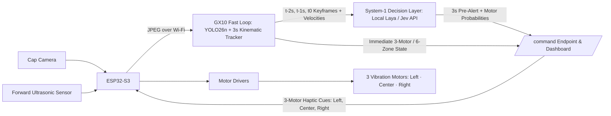

# RAGging Canes

A wearable spatial obstacle-awareness system that turns forward camera observations into real-time directional haptic cues and a 3-second future hazard forecast. Built for the ASUS Local AI track at the UCSC AI Hackathon (October 10–11, 2026).

See [Integration review](INTEGRATION_REVIEW.md) for model benchmarks, [DASHBOARD.md](DASHBOARD.md) for dashboard calibration and replay setup, and [HANDOFF.md](HANDOFF.md) for deployment history.

For the implemented confidence-and-distance motor strength path, see [HAPTICS.md](HAPTICS.md). It adds a dedicated v2 command endpoint and ESP32 receiver/PWM adapter; deployment and physical integration remain pending.

---

## System Architecture

The wearable is a baseball cap equipped with a Freenove ESP32-S3 WROOM camera board, an ultrasonic proximity sensor, and **3 directional vibration motors (`[Left, Center, Right]`)**. Frames stream over Wi-Fi to an **ASUS Ascent GX10** (NVIDIA GB10 GPU), which runs a dual-speed perception and decision pipeline:

1. **Fast Reflex Loop (~15–25 ms, synchronous):**
   - **YOLO26n (`yolo26n.pt`)** detects people, chairs, and obstacles on incoming frames (with hardware mount rotation preprocessing).
   - **3-Second Kinematic Trajectory Predictor (`TrajectoryPredictor`)** tracks multi-object velocities with EMA smoothing, ego-motion camera-pan compensation, and 4-stage physical realism filtering ($\le 4.5\text{ m/s}$ human speed cap, scale-depth coherence, temporal persistence). Projects `0.5s`, `1.0s`, `2.0s`, and `3.0s` future bounding boxes, ground-plane paths, Time-To-Collision (`ttc_s`), and 3-motor / 6-sector occupancy.
2. **System-1 Decision Loop (~80–175 ms, asynchronous background worker):**
   - **`DecisionForecaster`** evaluates a rolling 3-keyframe temporal window ($t_{-2\text{s}}, t_{-1\text{s}}, t_0$) and tracked velocity vectors to arbitrate realistic collision risk and recommend 3-motor pre-alerts (`recommended_pre_alert_zones_3: [L, C, R]`) and continuous per-motor activation probabilities (`motor_probabilities_3: [p_Left, p_Center, p_Right]`).
   - Supports live one-click toggling between:
     - **Local Laya (`convaiinnovations/laya`)**: Open-source System-1 decision model running locally on GPU/MPS (~83 ms, 3 parallel `noul` motor heads, 100% offline).
     - **TypeSafe Jev API (`jev-latest` / `/v1/systemone`)**: Cloud System-1 model returning calibrated 6-class hazard decisions + 3-motor probabilities (~175 ms) with automatic offline fallback to Local Laya.
     - **Kinematic Rules**: Deterministic Kalman/EMA trajectory fallback (<1 ms).



---

## Project Status & Backends

All 30 unit and integration tests pass (`python3 -m unittest discover -s tests -v`). The 3-motor haptic MVP (`[Left, Center, Right]`) is active across the vision backend, dashboard, and firmware client while maintaining backward compatibility with the 6-sector sub-grid (`L3, L2, L1, R1, R2, R3`).

| Component / Backend | Module | Output / Haptic Mapping | Firmware Client | Docs |
| --- | --- | --- | --- | --- |
| **YOLO26n + 3s Trajectory + Laya/Jev Decision** | `software.vision` & `software.predictor` | `zones_3: [L, C, R]` (3-motor MVP) + `zones: [L3..R3]` (6-sector) | [`firmware/ThreeZoneClient.h`](firmware/ThreeZoneClient.h) / [`firmware/SixZoneClient.h`](firmware/SixZoneClient.h) | [YOLO setup](software/README.md) |
| **Tesla-Style Surround View Dashboard** | `software.dashboard` | Live MJPEG + 60 FPS HUD, top-down radar, 3-motor bar, Laya/Jev toggle | Browser at `http://127.0.0.1:8080` | [Dashboard guide](DASHBOARD.md) |
| **Legacy Nemotron (`nemotron3:33b` via Ollama)** | `gx10.service` | 5 pixel-strip zones / 2500 ms expiry | [`firmware/ZoneClient.h`](firmware/ZoneClient.h) | [Nemotron setup](gx10/README.md) |

---

## Haptic Feedback: 3-Motor Wearable MVP

To keep the hardware wearable lightweight and immediately intuitive, the 6 camera sub-sectors (`L3, L2, L1, R1, R2, R3`) map onto **3 physical vibration motors**:

- **Motor 1 — `LEFT`** (`L3 | L2`): Left peripheral obstacle (`steady_left_nudge`) or pedestrian crossing Left $\rightarrow$ Center (`left_to_center_sweep`).
- **Motor 2 — `CENTER`** (`L1 | R1`): Forward collision corridor (`urgent_center_pulse`).
- **Motor 3 — `RIGHT`** (`R2 | R3`): Right peripheral obstacle (`steady_right_nudge`) or pedestrian crossing Right $\rightarrow$ Center (`right_to_center_sweep`).

Compact 3-motor output format (`/command?zones=3` or `zones_3` field):

```json
{
  "zones_3": [1, 1, 0],
  "motor_probabilities_3": [0.97, 0.94, 0.04],
  "haptic_pattern": "left_to_center_sweep"
}
```

| Value | Meaning |
| --- | --- |
| `1` | Obstacle active or predicted in this motor's sector. |
| `0` | Sector clear (or transient head-turn/sensor noise suppressed by realism filter). |
| `-1` | Sector could not be assessed (expired or camera offline). |

---

## Running the Dashboard & Vision Pipeline

### 1. Surround View Dashboard (Live Camera, Replay, or Simulation)

On the GX10 (or locally via `.venv-dashboard`):

```bash
.venv/bin/python -m software.dashboard \
  --mode live \
  --camera-url http://ESP32_IP/capture \
  --model yolo26n.pt \
  --device 0 \
  --port 8080 \
  --rife-factor 0
```

Open `http://127.0.0.1:8080` (tunneled from GX10 over SSH if viewing on laptop). Dashboard controls allow live switching between:
- **Source:** `Live Camera` (`270°` mount compensation), `Recorded Video` (`replay`), and `Synthetic Demo` (`simulation`).
- **Decision Model Toggle:** One-click switch between `⚡ Local Laya`, `☁️ Jev API`, and `📐 Kinematic` (`POST /api/decision`).
- **RIFE Interpolation:** Optional `Off` (default), `2×`, or `4×` optical-flow intermediate frame synthesis (`POST /api/rife`).
- **Ground-Plane Calibration:** Interactive 4-point floor homography for metric distance projection on the top-down radar.

### 2. Configuring Jev API & Local Laya

- **Local Laya (`convaiinnovations/laya`):** Runs out of the box in `.venv` / `.venv-dashboard` (`pip install laya`) using local Hugging Face weights on CUDA or Apple Silicon MPS.
- **TypeSafe Jev API (`jev-latest`):** Place your TypeSafe API key in `private/jev_api_key.txt` (git-ignored, `chmod 600`) or export `JEV_API_KEY`. If the network is unreachable, `DecisionForecaster` automatically falls back to Local Laya.

### 3. Standalone Vision Command Server (for ESP32 Polling)

```bash
.venv/bin/python -m software.vision pull --detect --device 0 \
  --url http://ESP32_IP/capture --host 127.0.0.1 --port 8001
```

- `GET /command` returns both `"zones"` (6-element array) and `"zones_3"` (3-element array `[Left, Center, Right]`).
- `GET /command?zones=3` returns the 3-element array directly in `"zones"` for [`firmware/ThreeZoneClient.h`](firmware/ThreeZoneClient.h).

### 4. Running Tests

```bash
.venv-dashboard/bin/python -m unittest discover -s tests -v
```

---

## Hardware Summary

| Component | Role / Current Detail |
| --- | --- |
| **Baseball cap** | Wearable mount for forward camera, ultrasonic sensor, and 3 haptic motors. |
| **Freenove ESP32-S3 WROOM** | Wi-Fi JPEG capture server, `/command?zones=3` polling client, and PWM motor driver control. |
| **3 directional vibration motors** | Left, Center, and Right motors driven via transistor/driver stage (never directly from GPIO). |
| **Forward ultrasonic sensor** | Direct hardware forward proximity reflex independent of Wi-Fi latency. |
| **ASUS Ascent GX10** | Local GPU inference host running YOLO26n, 3-second Kalman/EMA trajectory tracking, and Local Laya System-1 decision inference. |

---

## Build Milestones

- [x] Capture and decode live JPEG stream from ESP32 snapshot endpoint with rotation preprocessing.
- [x] Establish laptop SSH tunnel and GX10 GPU inference pipeline (`yolo26n.pt`).
- [x] Implement Tesla-style Surround View Dashboard with top-down radar and 4-point floor calibration.
- [x] Implement 3-second kinematic trajectory predictor (`TrajectoryPredictor`) with ego-motion and physical realism filtering.
- [x] Integrate System-1 Decision Layer (`DecisionForecaster`) supporting both **Local Laya** (~83 ms) and **TypeSafe Jev API** (~175 ms) with live UI toggle.
- [x] Adapt directional haptics to the **3-motor wearable MVP (`[Left, Center, Right]`)** and add [`firmware/ThreeZoneClient.h`](firmware/ThreeZoneClient.h).
- [ ] Complete physical 3-motor cap wiring, driver verification, and live stationary/walking wearable demonstration.
